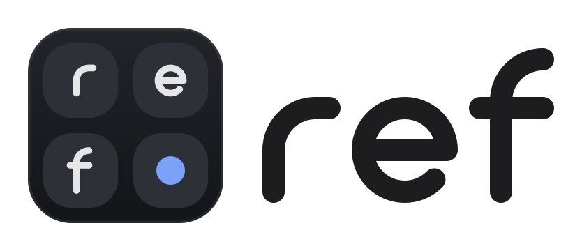
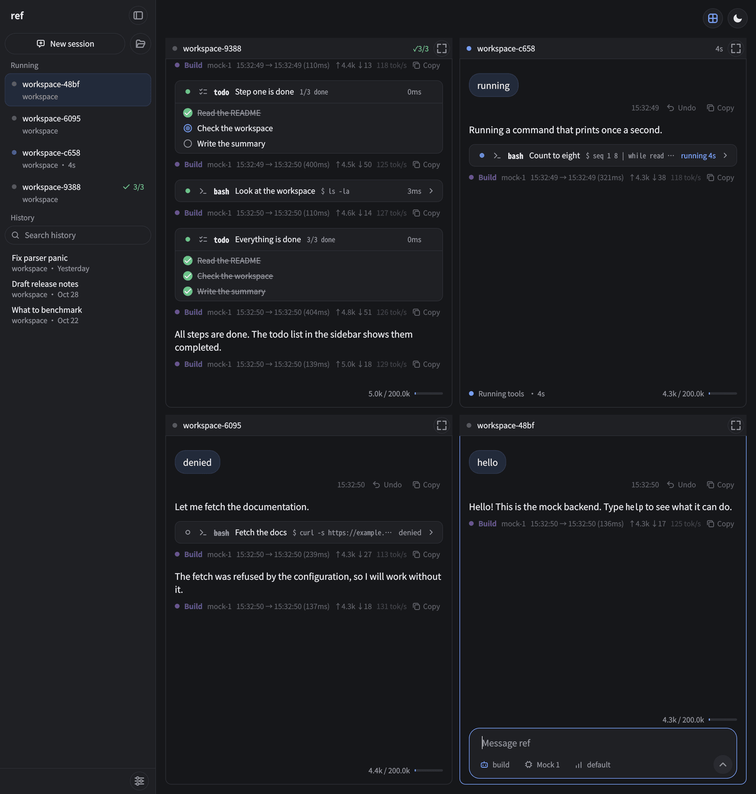
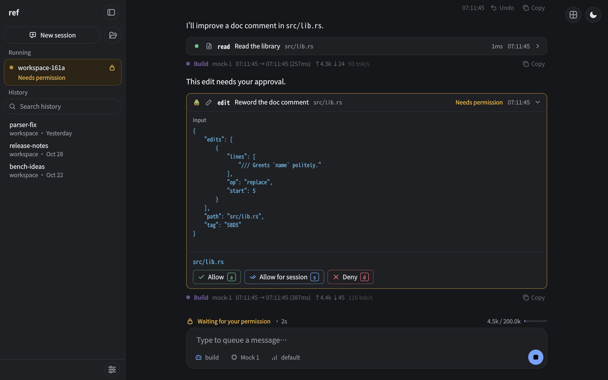
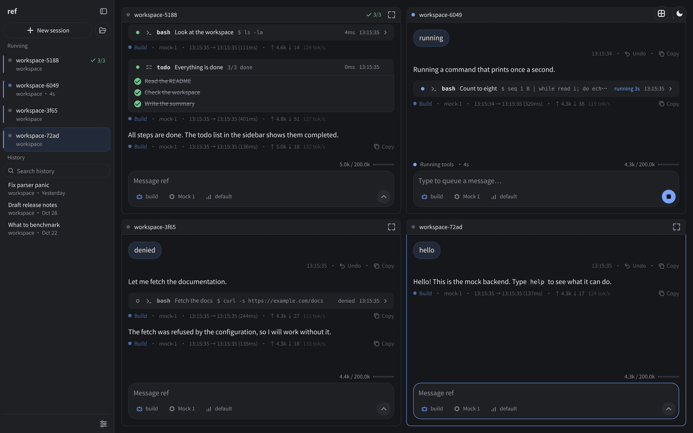

<div align="center">

<h1>
  <picture>
    <source media="(prefers-color-scheme: dark)" srcset="assets/app/ref-lockup-dark.svg">
    
  </picture>
</h1>

**A coding agent written in Rust, for the terminal, the desktop and the browser.**

Sessions run in a server, apart from the windows that show them.
Several sessions can work side by side and message each other.

[](https://github.com/GDNDZZK/ref/actions/workflows/ci.yml)
[](https://github.com/GDNDZZK/ref/releases/latest)
[](LICENSE)


**English** · [简体中文](README.zh-CN.md)

<br>



<sub>Four sessions at work in the split view of the desktop GUI.</sub>

</div>

---

## Features

- **Server and interfaces are separate.** `ref-server` runs sessions, the agent loop, LLM calls, tools and permissions. `ref` (terminal), `ref-gui` (desktop window) and `ref-web` (browser) only show them. Sessions keep running as long as any window (terminal, desktop or browser) is connected, so you can close one and continue in another, or have several open at once. A server started by one of them exits when the last window disconnects, and running sessions stop. To keep them running with no window open, start `ref-server` yourself: `ref-server` runs until you stop it, and the interfaces connect to it.
- **Many sessions at once.** A split view tiles all background sessions. Sessions can send each other messages, and the `build` agent can start worker sessions and give them tasks.
- **Reads opencode configuration.** ref loads the providers, models, agents, permissions, MCP servers and commands of an existing `opencode.json`. A few keys are accepted and ignored; see [Configuration](docs/configuration.md).
- **Three provider APIs.** Anthropic Messages, OpenAI Responses and any OpenAI-compatible Chat Completions endpoint, with model variants for reasoning effort or extended thinking. There is no native Gemini or Bedrock client.
- **Control over tool calls.** Allow, ask or deny per tool, with patterns for commands, paths and URLs, plus optional countdowns before a tool runs.
- **Reliable file edits.** Edits address hash-tagged line numbers, so a stale view of a file is detected instead of corrupting it.
- **Long sessions.** Automatic context compaction, retries without limit for rate limits and outages, and image downscaling for every provider.
- **MCP** servers over stdio and Streamable HTTP.
- **Linux, macOS and Windows**, on x86_64 and arm64.

## Interfaces

All three show the same sessions, and a session can be open in several of them at once.

<div align="center">



<sub><b>Desktop GUI</b> (<code>ref-gui</code>). A tool waits for permission: allow (a), allow for the session (s) or deny (d).</sub>



<sub><b>Browser</b> (<code>ref-web</code>). The same interface, here with the split view.</sub>


<sub><b>Terminal</b> (<code>ref</code>). Tool calls, replies and the input box.</sub>

</div>

## Installation

### Download

Pick an interface, then get the archive for your system from the [latest release](https://github.com/GDNDZZK/ref/releases/latest). Every archive has the interface, `ref-server` (the backend), both READMEs, the license and `docs/`.

| Interface | Archive | Contents |
|---|---|---|
| Terminal (TUI) | `ref-tui-<version>-<platform>` | `ref`, `ref-server` |
| Desktop (GUI) | `ref-gui-<version>-<platform>` | `ref-gui` (on macOS `ref.app`), the libraries it needs, `ref-server` |
| Browser (Web) | `ref-web-<version>-<platform>` | `ref-web`, `ref-server` |
| All | `ref-all-<version>-<platform>` | `ref`, `ref-gui`, `ref-web`, `ref-server` |

| System | `<platform>` and file type |
|---|---|
| Linux x86_64 | `x86_64-unknown-linux-gnu.tar.gz` |
| Linux arm64 | `aarch64-unknown-linux-gnu.tar.gz` |
| macOS Apple silicon | `aarch64-apple-darwin.tar.gz` |
| macOS Intel | `x86_64-apple-darwin.tar.gz` |
| Windows x86_64 | `x86_64-pc-windows-msvc.zip` |
| Windows arm64 | `aarch64-pc-windows-msvc.zip` |

For example, `ref-tui-v0.2.0-x86_64-unknown-linux-gnu.tar.gz`. Unpack it and put the programs **in the same directory** on your `PATH`; each interface looks for `ref-server` next to itself:

```bash
tar -xzf ref-tui-*.tar.gz
install -m 755 ref-tui-*/ref ref-tui-*/ref-server ~/.local/bin/
```

The GUI archives are folders that must stay together: `ref-gui` finds its libraries, plugins and `ref-server` in its own folder. Unpack the folder where you want to keep it and run `ref-gui` from there.

All interfaces share one backend. If you installed several, any of them connects to the backend that is already running.

- **Linux**: `ref`, `ref-web` and `ref-server` need glibc 2.35 or newer (Ubuntu 22.04, Debian 12, Fedora 36, RHEL 10, Arch and newer). NixOS needs `programs.nix-ld.enable = true`.
- **Linux GUI**: needs glibc 2.38 and the C++ runtime of GCC 13 (`libstdc++` with `CXXABI_1.3.14`): Ubuntu 24.04, Debian 13, Fedora 39, Arch and newer. It does not start on Ubuntu 22.04 or Debian 12; in the `ref-all` archive only the GUI is affected there. It runs on X11 and, through XWayland, on Wayland; a Wayland session without XWayland is not supported (Unverified). It needs these system libraries, most of which a desktop has: `libxcb-cursor0`, `libxkbcommon-x11-0`, `libxcb-icccm4`, `libxcb-image0`, `libxcb-keysyms1`, `libxcb-randr0`, `libxcb-render-util0`, `libxcb-shape0`, `libxcb-xkb1`, `libegl1`, `libfontconfig1` and `libdbus-1-3` (Debian and Ubuntu package names). To add `ref` to your application menu, copy the desktop file and the icon, and link the program into your `PATH`:

  ```bash
  install -Dm644 ref-gui.desktop ~/.local/share/applications/ref-gui.desktop
  install -Dm644 ref.svg ~/.local/share/icons/hicolor/scalable/apps/ref.svg
  ln -s "$PWD/ref-gui" ~/.local/bin/ref-gui
  ```
- **macOS**: the programs are not signed with a developer certificate (`ref.app` has an ad-hoc signature). If macOS blocks them, run `xattr -dr com.apple.quarantine ref ref-web ref-server ref.app` (the names that are in your archive). `ref.app` can be moved to `/Applications`.
- **Windows**: install [Git for Windows](https://git-scm.com/download/win); the `bash` tool uses its Git Bash. The programs are not signed, so Windows may warn about an unknown publisher the first time. The GUI needs no installation: run `ref-gui.exe`; the Visual C++ runtime is in the folder.

Each release has a `SHA256SUMS` file for checking the download.

### Build from source

```bash
git clone https://github.com/GDNDZZK/ref.git
cd ref
(cd web && pnpm install && pnpm build)   # needs Node 24 and pnpm; ref-web embeds the result
cargo build --release                    # needs current stable Rust and a C compiler
./target/release/ref
```

The GUI is built separately with CMake and Qt, see [Development](docs/development.md#the-gui).

## Quick start

1. Set an API key, for example `export ANTHROPIC_API_KEY=...`. `OPENAI_API_KEY`, `DEEPSEEK_API_KEY` and `OPENROUTER_API_KEY` work too. For other providers, see [Configuration](docs/configuration.md#providers-and-models).
2. Run `ref` in your project directory.
3. Type a task and press `enter`.

To use a desktop window instead, run `ref-gui` in your project directory ([Desktop GUI](docs/gui.md)); for the browser, run `ref-web` ([Web UI](docs/web.md)), which opens the page.

Keys in the terminal UI:

| Key | Action |
|---|---|
| `ctrl+x m` / `ctrl+x a` | Pick a model / an agent |
| `tab` | Next agent (`build` edits, `plan` only reads) |
| `ctrl+x l` | Sessions, live and past |
| `ctrl+x w` | Split view of background sessions |
| `esc esc` | Interrupt |
| `ctrl+x h` | All keys and commands |

## Documentation

| Document | Contents |
|---|---|
| [Using ref](docs/usage.md) | Sessions, the screen, prompts, keybindings, slash commands, split view, working with several sessions |
| [Configuration](docs/configuration.md) | Every configuration key: providers and models, agents, permissions, delays, compaction, MCP, commands, instructions and skills |
| [Tools](docs/tools.md) | What the model can do: file tools, bash, webfetch, image handling, context and cross-session tools |
| [Desktop GUI](docs/gui.md) | `ref-gui`: installing, starting, the window, split view, conversation, shortcuts, settings, notifications |
| [Web UI](docs/web.md) | `ref-web`: starting, signing in, opening it to the network, using the page, shortcuts, notifications, developing the page |
| [Command line](docs/cli.md) | `ref`, `ref-gui`, `ref-web` and `ref-server` options, remote backends, files and environment variables |
| [Development](docs/development.md) | Building, tests, crate layout, CI and releases |

## Acknowledgements

The GUI is adapted from an early version of qutie by LightBlueCube.

## License

[GPL-3.0](LICENSE)
