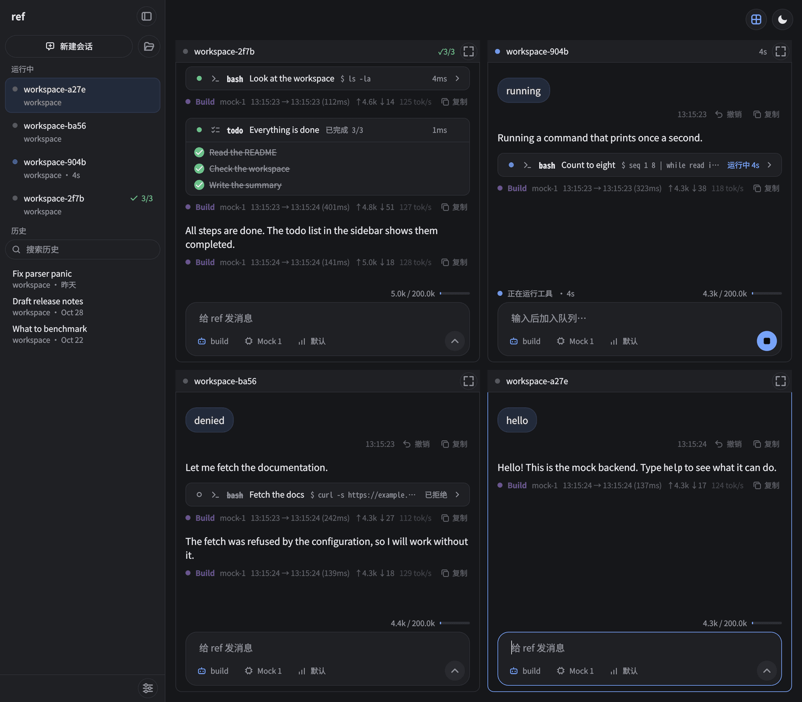
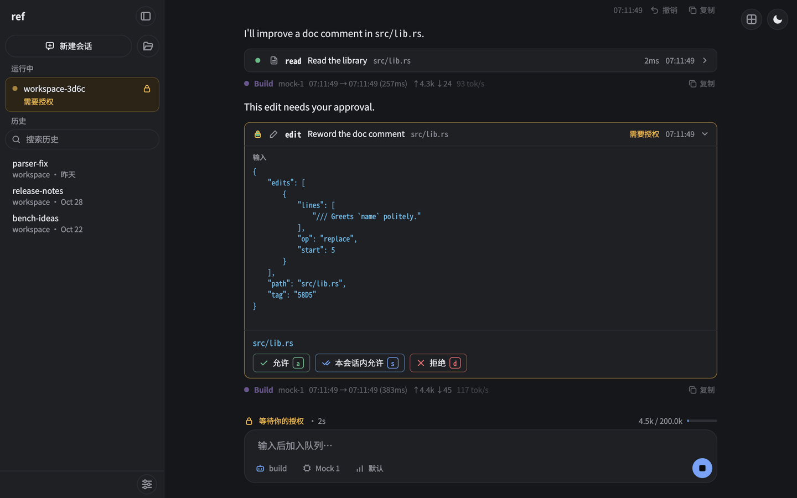
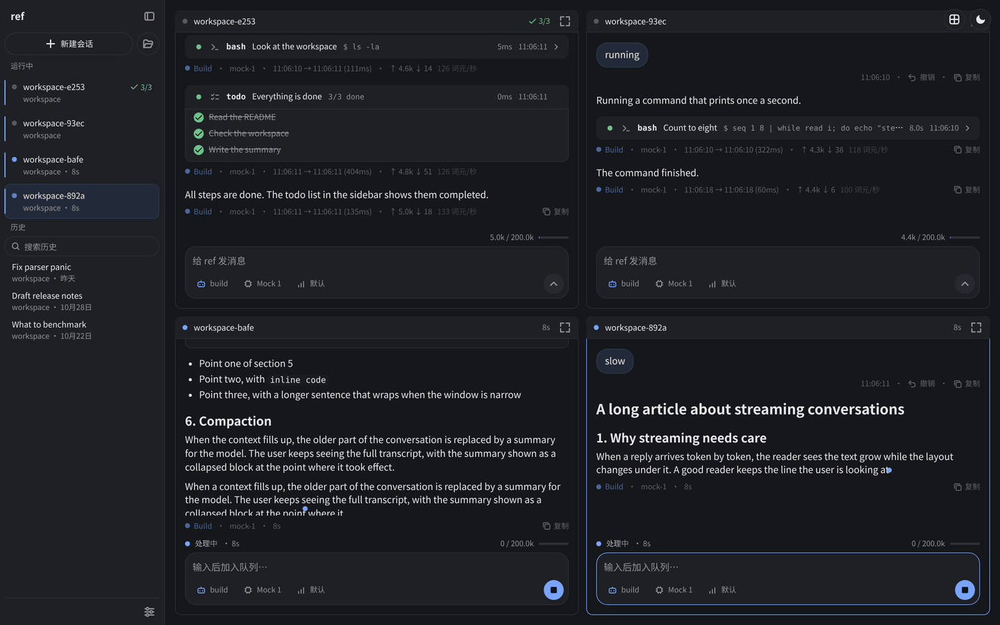
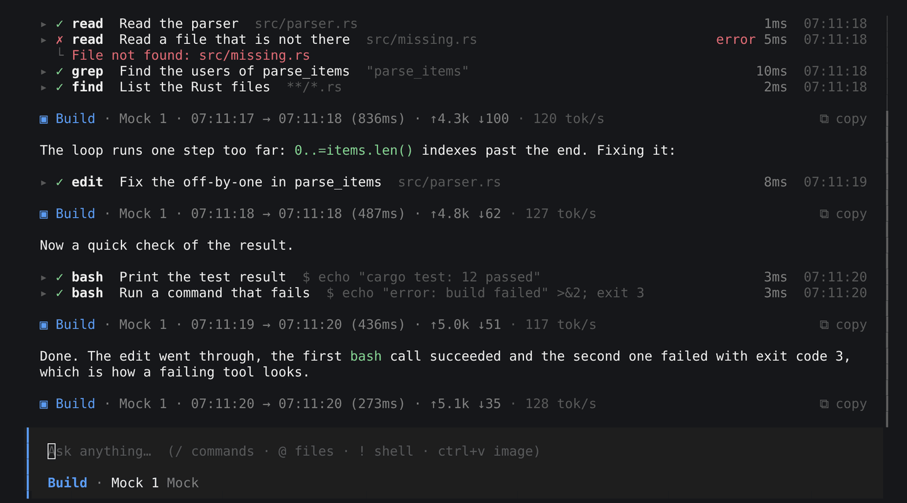

<div align="center">

# ref

**用 Rust 编写的编程智能体，可在终端、桌面窗口和浏览器中使用。**

会话运行在服务器中，与显示它们的窗口分开。
多个会话可以并行工作，并互相发送消息。

[](https://github.com/GDNDZZK/ref/actions/workflows/ci.yml)
[](https://github.com/GDNDZZK/ref/releases/latest)
[](LICENSE)


[English](README.md) · **简体中文**

<br>



<sub>桌面 GUI 的分屏视图中，四个会话同时在工作。</sub>

</div>

---

## 特性

- **服务器与界面分离。** `ref-server` 负责运行会话、智能体循环、LLM 调用、工具和权限，`ref`（终端）、`ref-gui`（桌面窗口）和 `ref-web`（浏览器）只负责显示。只要还有任何一个窗口（终端、桌面窗口或浏览器）连着，会话就会继续运行，所以可以关掉一个、在另一个里继续，也可以同时在几个里打开。由其中一个启动的服务器会在最后一个窗口断开时退出，正在运行的会话随之停止。想在没有窗口时让会话继续运行，请自己启动 `ref-server`：它会一直运行到你停止它，各个界面再连接到它。
- **同时运行多个会话。** 分屏视图平铺显示所有后台会话。会话之间可以互发消息，`build` 智能体可以启动工作会话并给它们分派任务。
- **读取 opencode 配置。** ref 会加载已有 `opencode.json` 中的提供商、模型、智能体、权限、MCP 服务器和命令。少数配置项会被接受但不起作用，详见[配置](docs/configuration.zh-CN.md)。
- **三种提供商接口。** 支持 Anthropic Messages、OpenAI Responses 和任何兼容 OpenAI 的 Chat Completions 端点，并可通过模型变体设置推理强度或扩展思考。没有原生的 Gemini 或 Bedrock 客户端。
- **可控的工具调用。** 按工具设置允许、询问或拒绝，可以按命令、路径和 URL 匹配模式，还可以在工具运行前加倒计时。
- **可靠的文件编辑。** 编辑基于带哈希标签的行号，文件视图过期时会被检测出来，而不会把文件改坏。
- **适合长会话。** 自动压缩上下文，遇到限流和服务中断时无限重试，并为所有提供商自动缩小图片。
- **MCP**：支持 stdio 和 Streamable HTTP 两种传输方式的服务器。
- **Linux、macOS 和 Windows**，支持 x86_64 和 arm64。

## 界面

三种界面显示的是同样的会话，同一个会话可以同时在多个界面中打开。

<div align="center">



<sub><b>桌面 GUI</b>（<code>ref-gui</code>）。工具在等待授权：允许（a）、本会话内允许（s）或拒绝（d）。</sub>



<sub><b>浏览器</b>（<code>ref-web</code>）。同一套界面，这里是分屏视图。</sub>



<sub><b>终端</b>（<code>ref</code>）。工具调用、回复和输入框。</sub>

</div>

## 安装

### 下载

先选界面，再从[最新发布版](https://github.com/GDNDZZK/ref/releases/latest)下载适合你系统的压缩包。每个压缩包都包含该界面、`ref-server`（后端）、两个 README、许可证和 `docs/`。

| 界面 | 压缩包 | 内容 |
|---|---|---|
| 终端（TUI） | `ref-tui-<version>-<platform>` | `ref`、`ref-server` |
| 桌面（GUI） | `ref-gui-<version>-<platform>` | `ref-gui`（macOS 上是 `ref.app`）、它需要的库、`ref-server` |
| 浏览器（Web） | `ref-web-<version>-<platform>` | `ref-web`、`ref-server` |
| 全部 | `ref-all-<version>-<platform>` | `ref`、`ref-gui`、`ref-web`、`ref-server` |

| 系统 | `<platform>` 与文件类型 |
|---|---|
| Linux x86_64 | `x86_64-unknown-linux-gnu.tar.gz` |
| Linux arm64 | `aarch64-unknown-linux-gnu.tar.gz` |
| macOS Apple 芯片 | `aarch64-apple-darwin.tar.gz` |
| macOS Intel | `x86_64-apple-darwin.tar.gz` |
| Windows x86_64 | `x86_64-pc-windows-msvc.zip` |
| Windows arm64 | `aarch64-pc-windows-msvc.zip` |

例如 `ref-tui-v0.2.0-x86_64-unknown-linux-gnu.tar.gz`。解压后，把程序放到 `PATH` 中的**同一个目录**；每个界面都会在自身所在目录查找 `ref-server`：

```bash
tar -xzf ref-tui-*.tar.gz
install -m 755 ref-tui-*/ref ref-tui-*/ref-server ~/.local/bin/
```

GUI 压缩包里是一个必须保持完整的文件夹：`ref-gui` 在自己所在的文件夹中查找库、插件和 `ref-server`。把文件夹解压到你想长期保存的位置，从那里运行 `ref-gui`。

所有界面共用同一个后端。如果装了多个界面，其中任何一个都会连接到已在运行的后端。

- **Linux**：`ref`、`ref-web` 和 `ref-server` 需要 glibc 2.35 或更新版本（Ubuntu 22.04、Debian 12、Fedora 36、RHEL 10、Arch 及更新版本）。NixOS 需要设置 `programs.nix-ld.enable = true`。
- **Linux 上的 GUI**：需要 glibc 2.38 和 GCC 13 的 C++ 运行库（带 `CXXABI_1.3.14` 的 `libstdc++`）：Ubuntu 24.04、Debian 13、Fedora 39、Arch 及更新版本。在 Ubuntu 22.04 和 Debian 12 上无法启动；`ref-all` 压缩包里只有 GUI 受影响。GUI 运行在 X11 上，在 Wayland 会话中通过 XWayland 运行；没有 XWayland 的纯 Wayland 会话不受支持（Unverified）。需要这些系统库，桌面系统大多已经有：`libxcb-cursor0`、`libxkbcommon-x11-0`、`libxcb-icccm4`、`libxcb-image0`、`libxcb-keysyms1`、`libxcb-randr0`、`libxcb-render-util0`、`libxcb-shape0`、`libxcb-xkb1`、`libegl1`、`libfontconfig1` 和 `libdbus-1-3`（Debian 和 Ubuntu 的包名）。想把 `ref` 加入应用菜单，复制 desktop 文件和图标，并把程序链接到 `PATH` 中：

  ```bash
  install -Dm644 ref-gui.desktop ~/.local/share/applications/ref-gui.desktop
  install -Dm644 ref.png ~/.local/share/icons/hicolor/256x256/apps/ref.png
  ln -s "$PWD/ref-gui" ~/.local/bin/ref-gui
  ```
- **macOS**：程序没有用开发者证书签名（`ref.app` 带有 ad-hoc 签名）。如果被 macOS 拦截，运行 `xattr -dr com.apple.quarantine ref ref-web ref-server ref.app`（以你的压缩包中实际有的程序为准）。`ref.app` 可以移到 `/Applications`。
- **Windows**：需要安装 [Git for Windows](https://git-scm.com/download/win)，`bash` 工具使用其中的 Git Bash。程序没有签名，第一次运行时 Windows 可能提示未知发布者。GUI 不需要安装：运行 `ref-gui.exe` 即可，Visual C++ 运行库已在文件夹中。

每个发布版都附带 `SHA256SUMS` 文件，用于校验下载内容。

### 从源码构建

```bash
git clone https://github.com/GDNDZZK/ref.git
cd ref
(cd web && pnpm install && pnpm build)   # 需要 Node 24 和 pnpm；ref-web 会嵌入构建结果
cargo build --release                    # 需要当前稳定版 Rust 和 C 编译器
./target/release/ref
```

GUI 用 CMake 和 Qt 单独构建，见[开发](docs/development.zh-CN.md#gui)。

## 快速开始

1. 设置 API 密钥，例如 `export ANTHROPIC_API_KEY=...`。也可以使用 `OPENAI_API_KEY`、`DEEPSEEK_API_KEY` 和 `OPENROUTER_API_KEY`。其他提供商请参阅[配置](docs/configuration.zh-CN.md#提供商与模型)。
2. 在项目目录中运行 `ref`。
3. 输入任务并按 `enter`。

想用桌面窗口，在项目目录中运行 `ref-gui`（[桌面 GUI](docs/gui.zh-CN.md)）；想用浏览器，运行 `ref-web`（[Web 界面](docs/web.zh-CN.md)），它会打开页面。

终端界面的按键：

| 按键 | 作用 |
|---|---|
| `ctrl+x m` / `ctrl+x a` | 选择模型 / 智能体 |
| `tab` | 切换到下一个智能体（`build` 可编辑，`plan` 只读） |
| `ctrl+x l` | 会话列表（运行中的和历史的） |
| `ctrl+x w` | 后台会话分屏视图 |
| `esc esc` | 中断 |
| `ctrl+x h` | 全部按键和命令 |

## 文档

| 文档 | 内容 |
|---|---|
| [使用 ref](docs/usage.zh-CN.md) | 会话、界面、提示输入、快捷键、斜杠命令、分屏视图、多会话协作 |
| [配置](docs/configuration.zh-CN.md) | 全部配置项：提供商与模型、智能体、权限、延迟、压缩、MCP、命令、指令和技能 |
| [工具](docs/tools.zh-CN.md) | 模型能做什么：文件工具、bash、webfetch、图片处理、上下文与跨会话工具 |
| [桌面 GUI](docs/gui.zh-CN.md) | `ref-gui`：安装、启动、窗口、分屏视图、对话、快捷键、设置、通知 |
| [Web 界面](docs/web.zh-CN.md) | `ref-web`：启动、登录、向局域网开放、使用页面、快捷键、通知、开发页面 |
| [命令行](docs/cli.zh-CN.md) | `ref`、`ref-gui`、`ref-web` 和 `ref-server` 的选项、远程后端、文件和环境变量 |
| [开发](docs/development.zh-CN.md) | 构建、测试、crate 结构、CI 和发布 |

## 致谢

GUI 改编自 LightBlueCube 的 qutie 早期版本。

## 许可证

[GPL-3.0](LICENSE)
